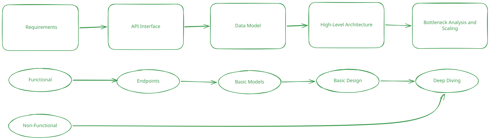
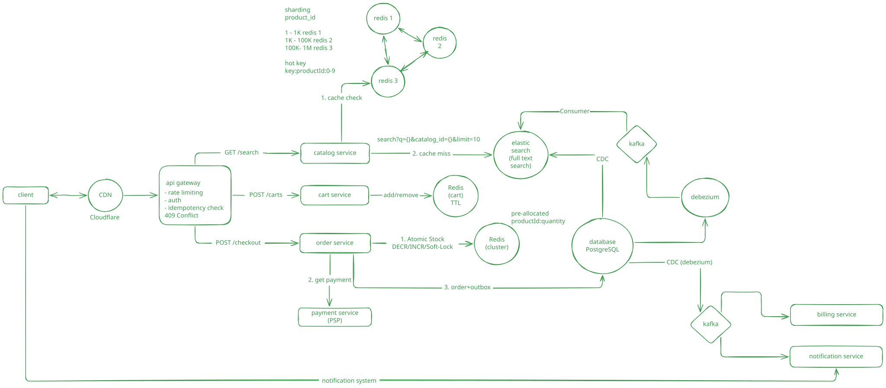
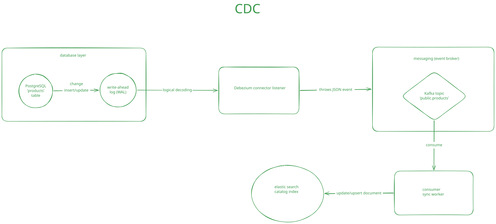

In this article, we will design a system for Trendyol Black Friday discount periods using the roadmap below.



<!-- truncate -->

### Functional Requirements

- Users can view flash sale products on the homepage and perform searches.
- Users can add selected products to their temporary shopping carts.
- Users can confirm their cart and complete the order via an external Payment Service Provider (PSP).

### Non-Functional Requirements (Scale Metrics)

- **Read-Heavy Traffic:** 500,000 requests per second (Catalog and Search)
- **Write-Heavy Traffic:** 200,000 requests per second (Cart and Checkout triggers)
- **Latency:** Search and listing response time at the P99 level must be < 400–500ms.
- **Data Consistency:** Strict consistency is essential for inventory operations. Overselling (selling a product that is out of stock) is unacceptable.

### API Interface

```
// Product search and listing (catalog service)
GET /products/search?q={term}&catalog_id={id}&limit={count} ==> Product[]

// Add item to cart (cart service - Redis)
Headers: bearer {token}
POST /carts/items
{
	product_id,
	quantity
} ==> 201, Cart

// Complete order (order service)
POST /orders/checkout
Headers: Idempotency-Key
{
	cart_id,
	payment_method,
	shipping_address_id
} ==> 201, Order
```

### Data Model

```
Product
- id
- category_id
- name
- description
- price
- ...

Cart
- id
- user_id
- product_id
- quantity
- ...
  
Inventory
- product_id
- quantity

Order
- id
- user_id
- product_model[]
- payment_details
- ...

order_outbox
- order_id
- status (completed, pending)
```

### High-Level Architecture

The end-to-end architectural design is illustrated below.



### Bottleneck Analysis and Scaling

#### Black Friday Order and Inventory Management

Roughly speaking, a single relational database (such as PostgreSQL) can handle tens of thousands of transactions per second under a write-heavy load. Redis, on the other hand, can scale up to hundreds of thousands on a single instance. Let's consider our first bottleneck scenario: during Black Friday, cart confirmations and payment flows are triggered at 200,000 requests per second.

If we decrement stock directly in PostgreSQL after every successful payment, intense row-level lock contention will occur on the inventory row of a popular discounted product. Other transactions will queue up, the connection pool will quickly exhaust, and CPU usage will hit the ceiling.

**Solution: Pre-allocating inventory in Redis.** Before the campaign starts, we load the stock quantities into Redis. When a user proceeds to checkout, the stock is atomically decremented on Redis using a Lua script, and a reservation (soft lock) is created for the user. If the item is out of stock or already reserved, the request is rejected without ever reaching the database. Redis absorbs the vast majority of the load, protecting the database.

The reservation in Redis is a temporary lock. We record each reservation alongside its expiration timestamp in a ledger (a Redis sorted set). The authority to release the stock belongs exclusively to the party that successfully deletes the record from this ledger. If the payment fails, the reservation is deleted and the stock is incremented back. A cleanup job periodically scans the ledger and restores the stock for expired reservations. If the payment succeeds, the record is deleted without incrementing the stock; the reservation becomes permanent by writing the order to the database. If a payment arrives after the expiration time, the record no longer exists, the order is not written, and the payment is refunded. Since only one party can delete the record, the stock is neither incremented twice nor left short. Through this method, only order records for users who have successfully reserved stock and completed payment are written to the database.

#### Key Considerations

Redis and Lua scripts make the flow fast and atomic, but they are not enough on their own. There are several critical practices that keep the system alive during peak days like Black Friday. Keeping the payment timeout shorter than the reservation timeout (e.g., 5 minutes for payment, 10 minutes for reservation) turns the "payment captured but reservation expired" scenario into a rare edge case; even if it occurs, the order is not created and the payment is refunded. Every checkout request must carry a unique idempotency key, and the API Gateway must reject duplicate keys with `409 Conflict` to prevent duplicate orders. Redis is a fast gatekeeper, not the single source of truth; therefore, the database must always have the final say, and an inventory check should also be performed in the database when writing the order. Finally, since counters could be lost if Redis crashes, there must be a mechanism to recalculate the counters from PostgreSQL's inventory and confirmed orders.

#### Handling 500K Reads Per Second

If we route incoming read requests directly to the database via `catalog-service`, the search feature in particular will rapidly bottleneck and the system could crash. To mitigate this load, we can adopt a multi-layered approach:

1. **Elasticsearch for Search:** By routing search queries to an intermediate Elasticsearch cluster instead of PostgreSQL, we offload this heavy query burden from the primary database.
2. **Caching with Redis Cluster:** Since information like product images and details does not change frequently, we can cache them on a clustered Redis setup. This prevents the vast majority of read requests from ever hitting the database.
3. **Edge Delivery with CDN:** We must consider not only search, but also the homepage. Since most users are generally shown the same products and discounts on the homepage, we can serve this content via a CDN. Thus, requests are fulfilled before even reaching our application servers.

#### The Hot Key Problem

During Black Friday, everyone queries the same few popular products or search terms. Because the cache keys for these products reside on a single shard in the Redis cache, all requests pile up on that single node. This is known as the hot key problem, turning that shard into a bottleneck. One solution is to store the same data across a fixed number of replicas, such as `productId:0` through `productId:9`, instead of a single key. Each request reads a random replica; since the replicas are distributed across different shards, the load is spread out. The trade-off is that every replica must be updated separately, and the cache hit ratio decreases as the number of replicas grows—therefore, the replica count must be kept fixed and low.

#### Atomic Operations with Redis Lua Scripts

Redis is single-threaded, and no other command can interleave while a Lua script is executing (atomicity).

Decrementing stock (acquiring a reservation):

```lua
-- KEYS[1] = "inventory:{1234}"     (stock counter)
-- KEYS[2] = "reservations:{1234}"  (ledger, sorted set)
-- ARGV[1] = "userId:quantity"      (ledger entry)
-- ARGV[2] = quantity
-- ARGV[3] = expiration time (unix timestamp)
local stock = tonumber(redis.call('GET', KEYS[1]))

if stock and stock >= tonumber(ARGV[2]) then
  redis.call('DECRBY', KEYS[1], ARGV[2])
  redis.call('ZADD', KEYS[2], ARGV[3], ARGV[1])
  return 1 -- Success, stock reserved (soft-lock)
else
  return 0 -- Failed, out of stock
end
```

Incrementing stock (releasing a reservation):

```lua
-- KEYS[1] = "inventory:{1234}"
-- KEYS[2] = "reservations:{1234}"
-- ARGV[1] = "userId:quantity"
-- ARGV[2] = quantity
if redis.call('ZREM', KEYS[2], ARGV[1]) == 1 then
  redis.call('INCRBY', KEYS[1], ARGV[2])
  return 1 -- Reservation existed, stock restored
else
  return 0 -- Record not found: already handled by another process, do nothing
end
```

When decrementing stock, we record the reservation in a ledger (sorted set). The script responsible for restoring stock first attempts to remove this reservation; it only increments the stock if the deletion succeeds. If the record is already gone, it means another process has already refunded it, so we leave the stock untouched. Because everything executes atomically within a single Lua script, even if the same refund arrives twice, the stock is incremented only once.

#### Change Data Capture (CDC)

In PostgreSQL, `INSERT` and `UPDATE` operations are fast because they are first written to the WAL (Write-Ahead Log) rather than directly to the data files on disk each time. Writing to the WAL is a sequential append operation, which is much cheaper than random disk I/O. The change is first applied in memory and logged to the WAL, while PostgreSQL's background processes (checkpointer, background writer) flush the changes to the respective data files later. Because this log maintains a sequential record of every change in the database, it can also be streamed externally.

The approach of capturing database changes in near real-time is called **CDC**. By setting `wal_level = logical` in PostgreSQL, WAL records become readable. **Debezium**, acting as a logical replication client, reads these records, converts them into a standardized event format, and streams them to Kafka. With a consumer, this pipeline can be used to keep Elasticsearch synchronized with PostgreSQL.

What happens if a data change (event) fails to be sent asynchronously to Kafka due to an issue right after writing the data to the database? This is exactly where the **Outbox Pattern** comes into play. Within the same database transaction that updates the primary table, the application also writes the corresponding event to an outbox table. This guarantees that either both the data and the event are saved together, or neither is saved. Debezium reads this table via the database's transaction log (WAL) and forwards the events to Kafka. Even if Debezium goes down for a while, it remembers its offset and resumes from where it left off once restarted, ensuring zero event loss. Because events are delivered with "at-least-once" semantics, consumers must be designed to be **idempotent** to handle the possibility of receiving duplicate events.



In this architecture, this pattern is used for the invoice/notification services and Elasticsearch.

### Conclusion

In this article, we explored how an e-commerce infrastructure can survive massive campaigns like Black Friday, where hundreds of thousands of requests pour in per second. While overcoming database lock contention under heavy write traffic using Redis and Lua script-based soft-lock mechanisms, we safely distributed the read load across Elasticsearch, Redis Cluster, and CDN layers. Furthermore, we ensured system-wide data consistency and reliable asynchronous workflows using CDC, Debezium, and the Outbox Pattern. Of course, like any architecture designed in theory, it is vital to validate and fine-tune this setup through comprehensive load and stress testing before exposing it to live traffic.

See you in future blog posts!

### References

[5 Major System Designs](https://mvpakademi.com/course/5-buyuk-sistem-tasarimi)